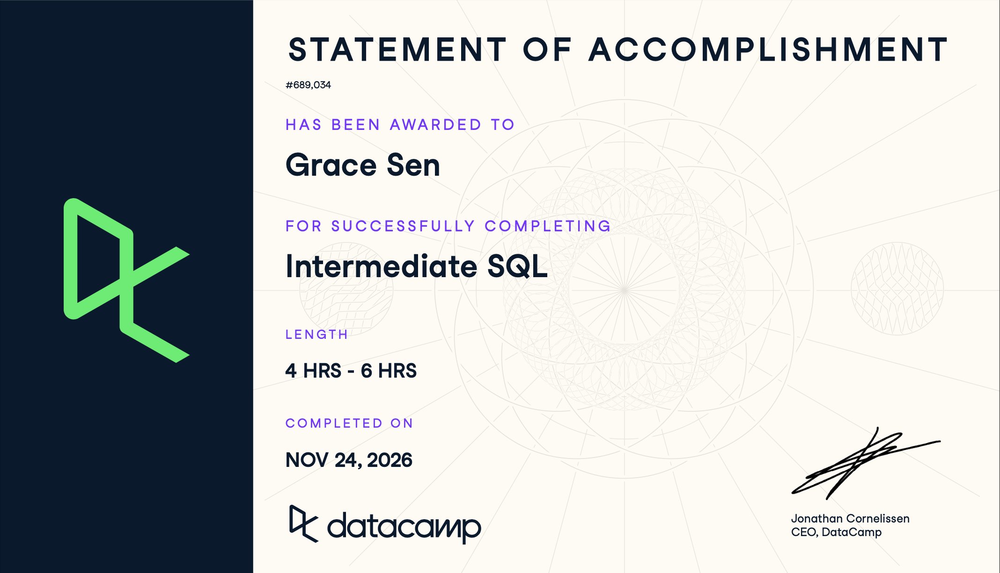

# Course-Completion Evidence



I completed the DataCamp **Intermediate SQL** course. The certificate above confirms my completion of the assigned course.

# Learning Notes and Key Takeaways

## Selecting Data

### Main Ideas

This chapter reviewed how to retrieve useful fields from a database and introduced better habits for writing SQL. I learned that `COUNT()` measures records, `DISTINCT` removes duplicate values, and the written order of SQL clauses is different from the order in which the database evaluates them. Clear formatting, indentation, and aliases make a query easier for another analyst to understand and reuse.

### Important SQL Syntax

- `SELECT` chooses columns or expressions.
- `FROM` identifies the source table.
- `COUNT(*)` counts all rows.
- `COUNT(column_name)` counts non-missing values in one column.
- `COUNT(DISTINCT column_name)` counts unique non-missing values.
- `AS` assigns a readable alias to a result column.

::: callout-important
## When to use

These tools are useful when first inspecting a dataset, checking its size, or determining how many unique customers, campaigns, or products it contains.
:::

### SQL Example

``` sql
SELECT
  COUNT(*) AS total_orders,
  COUNT(DISTINCT customer_id) AS unique_customers
FROM orders;
```

This query returns one row. It shows the total number of order records and the number of distinct customers represented in the table. The two values are different because one customer can place more than one order.

### CEP Application

For a digital marketing or CEP project, this pattern could compare total transactions with unique customers. It would help prevent me from confusing repeated customer activity with the number of individual customers reached.

## Filtering Records

### Main Ideas

Filtering keeps only the records that match an analytical question. Numerical and text conditions can be combined with `AND` and `OR`. `BETWEEN` checks a range, `IN` checks a list of values, and `LIKE` matches a text pattern. Missing values require `IS NULL` or `IS NOT NULL` rather than an equals sign.

### Important SQL Syntax

- `WHERE` filters rows before aggregation.
- `AND` requires all connected conditions to be true.
- `OR` requires at least one connected condition to be true.
- `BETWEEN` filters an inclusive range.
- `IN` matches any value in a list.
- `LIKE` and `NOT LIKE` match or exclude text patterns.
- `IS NULL` and `IS NOT NULL` identify missing values.

::: callout-important
## When to use

Filtering is useful when an analysis should focus on a specific time period, market, campaign, customer segment, or outcome.
:::

### SQL Example

``` sql
SELECT
  campaign_name,
  channel,
  revenue
FROM campaign_results
WHERE channel IN ('Email', 'Social Media')
  AND revenue BETWEEN 1000 AND 10000
  AND campaign_name IS NOT NULL;
```

This query keeps Email and Social Media campaigns with revenue from 1,000 through 10,000. It also removes records with a missing campaign name. The output can be used to compare a defined group of valid campaigns instead of the entire table.

### CEP Application

I could use these filters to study campaigns from selected channels, remove incomplete records, and limit an analysis to the period that matches a business question.

## Aggregate Functions

### Main Ideas

Aggregate functions summarize many rows into a smaller number of results. `SUM()`, `AVG()`, `MIN()`, and `MAX()` describe totals, averages, and ranges. Arithmetic expressions create new metrics, while `ROUND()` makes numerical output easier to present. Aliases make calculated columns understandable.

### Important SQL Syntax

- `SUM()` adds numerical values.
- `AVG()` calculates a mean.
- `MIN()` and `MAX()` return the lowest and highest values.
- `ROUND(value, digits)` controls displayed precision.
- Arithmetic operators such as `+`, `-`, `*`, and `/` create calculated measures.
- `WHERE` can limit the records included in an aggregate.

::: callout-important
## When to use

Aggregates are useful for summarizing revenue, cost, conversions, order value, or other performance measures.
:::

### SQL Example

``` sql
SELECT
  ROUND(SUM(revenue), 2) AS total_revenue,
  ROUND(AVG(revenue), 2) AS average_campaign_revenue,
  ROUND(SUM(revenue) / NULLIF(SUM(marketing_cost), 0), 2) AS revenue_to_cost_ratio
FROM campaign_results
WHERE campaign_status = 'Completed';
```

This query summarizes completed campaigns. It reports total revenue, average revenue, and the ratio of revenue to marketing cost. `NULLIF()` prevents a division-by-zero error if total marketing cost is zero.

### CEP Application

This pattern could summarize campaign performance and calculate a simple efficiency measure. Similar expressions could support return-on-investment, average order value, or conversion-rate calculations.

## Sorting and Grouping

### Main Ideas

`GROUP BY` changes the level of analysis by creating one result for each category. `ORDER BY` sorts the output so the most important results are easy to find. `HAVING` filters groups after aggregate calculations, while `WHERE` filters individual rows before grouping. A query can group by more than one field to compare results across several dimensions.

### Important SQL Syntax

- `GROUP BY` creates one summary row per group.
- `ORDER BY` sorts results in ascending or descending order.
- `ASC` sorts from lowest to highest.
- `DESC` sorts from highest to lowest.
- `HAVING` filters aggregated groups.
- `LIMIT` restricts the number of displayed results.

::: callout-important
## When to use

Grouping and sorting are useful when comparing performance across channels, products, regions, customer groups, or time periods.
:::

### SQL Example

``` sql
SELECT
  channel,
  COUNT(*) AS campaigns,
  ROUND(SUM(revenue), 2) AS total_revenue
FROM campaign_results
WHERE campaign_status = 'Completed'
GROUP BY channel
HAVING COUNT(*) >= 3
ORDER BY total_revenue DESC;
```

This query creates one row for each marketing channel. It keeps only channels with at least three completed campaigns and ranks them from the highest to the lowest total revenue. `WHERE` filters campaign records before grouping, while `HAVING` filters the completed group summaries.

### CEP Application

I could use this structure to rank channels or promotions and identify which categories produced the strongest results. Requiring a minimum number of campaigns can also reduce the chance of drawing conclusions from a group with very little data.

# Overall Reflection and Series Synthesis

The most useful intermediate SQL patterns were filtering with several conditions and combining `GROUP BY`, aggregate functions, `HAVING`, and `ORDER BY`. Together, these tools turn raw records into focused comparisons that can answer business questions. The difference between `WHERE` and `HAVING` was initially challenging, but it became clearer when I remembered that `WHERE` filters rows before grouping and `HAVING` filters the resulting groups.

This course extended Introduction to SQL by moving beyond basic retrieval. I can now define a relevant subset, calculate performance measures, compare categories, and organize the output for interpretation. In BigQuery, these skills could support analysis of GA4 events, campaign performance, sales, customer behavior, or survey data while limiting unnecessary processing through careful filters.

For future work, I expect to revisit the sections on filtering missing values, aggregate calculations, and grouped analysis. These patterns will be especially helpful when preparing CEP data and translating a marketing question into a reproducible query.

# Appendix: Publication Links

- [GitHub Repository](https://github.com/gracesen/ibm-6500-sql-learning-portfolio)
- [Published Intermediate SQL Report](https://gracesen.github.io/ibm-6500-sql-learning-portfolio/intermediate-sql.html)
- [Published Portfolio Landing Page](https://gracesen.github.io/ibm-6500-sql-learning-portfolio/)
